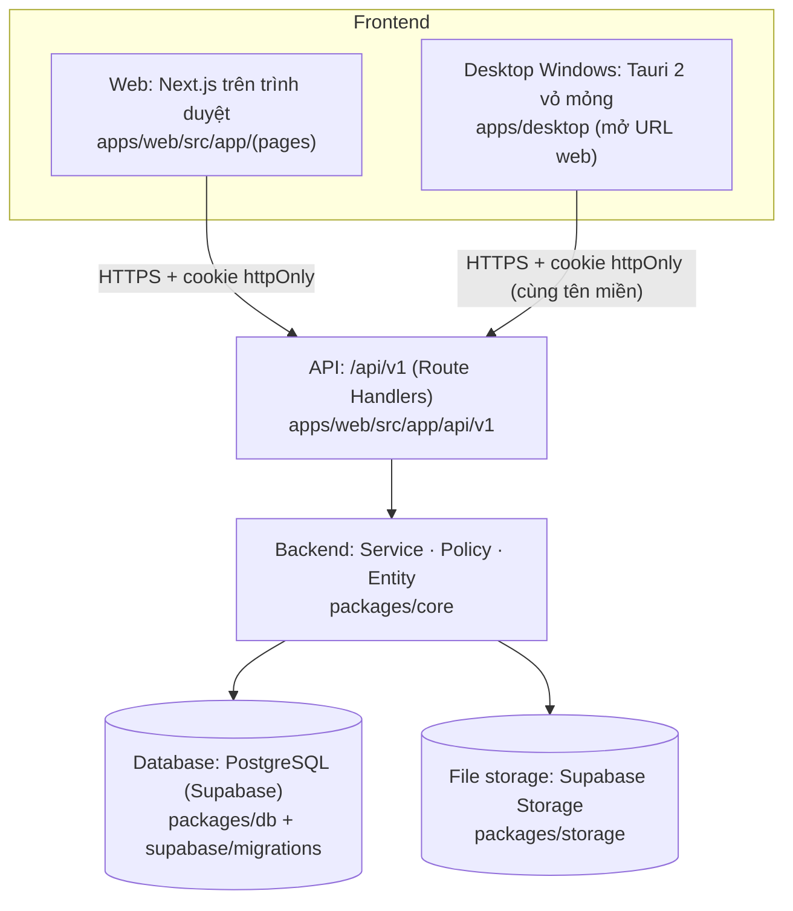

# Kiến trúc TS24-HTKH

Tài liệu này là **nguồn chuẩn** của kiến trúc. Whiteboard "TS24-HTKH: kiến trúc monorepo" chỉ là bản hình minh họa:
khi hai nơi khác nhau, tài liệu này đúng. Mọi thay đổi kiến trúc đi kèm một ADR trong `docs/adr/`.

## 1. Sơ đồ 5 lớp



| Lớp | Vị trí | Trách nhiệm | Không được |
|---|---|---|---|
| Frontend | `apps/web/src/app/(pages)`, `components/`, `features/`, `lib/`; `apps/desktop` | Hiển thị, form, gợi ý quyền (ẩn/hiện nút) | Chứa luật nghiệp vụ, gọi Supabase trực tiếp |
| API | `apps/web/src/app/api/v1/**/route.ts` | Đọc request, `requireUser()`, kiểm input (zod), gọi service, trả JSON + mã lỗi | Viết SQL, chứa nghiệp vụ |
| Backend | `packages/core` | Nghiệp vụ, phân quyền (Policy), nhật ký, tích hợp TS24 | Biết về HTTP, import `react`/`next` |
| Database | `packages/db`, `supabase/migrations` | Kết nối, transaction, repository, soft delete; schema, constraint, trigger, RLS | Chứa luật nghiệp vụ trong repository |
| File storage | `packages/storage` | Interface `FileStorage` + `SupabaseFileStorage` | Bucket public |

Package dùng chung:
- `packages/shared`: logic thuần (kỳ, quý, tuần lịch), hằng số, schema zod. Không IO, không phụ thuộc package nào.
- `packages/xlsx-report`: điền mẫu WR/MR/QR, lịch, đối soát bằng sửa XML ô.
- `packages/platform`: interface `Platform` (lưu file, thông báo, mở link) + `WebPlatform`, `TauriPlatform`.
- `packages/config`: tsconfig, eslint, prettier.

## 2. Quy tắc phụ thuộc

Được kiểm tra trong CI bằng `pnpm depcruise` (`.dependency-cruiser.cjs`). Mũi tên = "được import".

```
apps/web (pages, components, features, lib) ──► shared, platform
apps/web (api)                              ──► core, shared
apps/desktop                                ──► (không package nghiệp vụ nào)
tools/*                                     ──► core, db, shared
core                                        ──► db, storage, xlsx-report, shared
db, storage, xlsx-report                    ──► shared
platform                                    ──► (không package nghiệp vụ nào)
shared                                      ──► (không gì cả)
```

- Package chỉ import những gì khai báo trong `dependencies` của nó (pnpm chặn import "ké").
- `core`, `db`, `storage` đánh dấu `server-only`, không khai báo `react`, `next`.
- Không phụ thuộc vòng.
- Mọi file trong `apps/web/src` không thuộc `app/api/` là lớp giao diện. Luật kiểm cả `import type` (ADR-0006).

## 3. Cây thư mục

```
ts24-htkh/
├─ apps/
│  ├─ web/                        @ts24-htkh/web — Next.js, deploy Vercel (Root Directory = apps/web)
│  │  ├─ src/app/(pages)/          login, kpi (kpi, kpi/mine, kpi/rates), team, reports, schedule, ts24, accounts
│  │  ├─ src/app/api/v1/           route handler mỏng → @ts24-htkh/core
│  │  │  └─ _lib/                  handle() (lỗi → JSON), parseVi() (thông báo zod tiếng Việt), requireUser(), cookie phiên
│  │  ├─ src/proxy.ts              gợi ý điều hướng theo cookie có/không (lớp giao diện, không phải luật)
│  │  ├─ src/components/           ConfirmDialog, DateRange, Chart
│  │  ├─ src/features/<nghiệp vụ>/ màn hình + hook (vd team: TeamKpiScreen)
│  │  ├─ src/lib/api-client.ts     nơi duy nhất giao diện gọi API
│  │  └─ tests/e2e/
│  └─ desktop/                    @ts24-htkh/desktop — Tauri 2 vỏ mỏng
│     ├─ src/offline.html
│     ├─ src-tauri/  (src/lib.rs, tauri.conf.json, tauri.store.conf.json, capabilities/remote.json, icons/)
│     └─ packaging/msix/
├─ packages/
│  ├─ core/                       src/policies/ (ma trận quyền), src/modules/ (auth, accounts, kpi: gồm team-kpi.service.ts, reports: ReportService + ReportPolicy), container.ts
│  ├─ db/  storage/  xlsx-report/  shared/  platform/  config/
├─ tools/
│  ├─ sheets-migration/           ETL một lần Google Sheet → PostgreSQL (chỉ đọc Sheet)
│  ├─ set-password/               CLI đặt mật khẩu khẩn cấp; đường chính là trang /accounts (runbooks/dat-mat-khau.md)
│  └─ backup-verify/
├─ supabase/                      migrations/ (team, app_user, user_session, audit_log, kpi_report, kpi_rate…), seed.sql, config.toml
├─ templates/                     file mẫu .xlsx gốc: report-WR.xlsx, report-MR.xlsx, report-QR.xlsx (đưa vào bản build Vercel qua outputFileTracingIncludes trong apps/web/next.config.ts)
├─ docs/                          architecture.md, adr/, specs/, plans/, runbooks/, GLOSSARY.md
├─ .claude/rules/                 quy tắc cho Claude Code theo vùng code
├─ .github/workflows/             ci.yml, deploy.yml, release-desktop.yml, backup.yml
├─ .dependency-cruiser.cjs  pnpm-workspace.yaml  turbo.json  package.json  .env.example
└─ CLAUDE.md  README.md
```

Bên trong một module nghiệp vụ (ví dụ `accounts`):

```
packages/core/src/policies/            permissions.ts (ma trận quyền dùng chung, ADR-0009) · *.test.ts
packages/core/src/modules/accounts/   account.service.ts · account.policy.ts · account.dto.ts · *.test.ts
packages/db/src/repositories/          user.repository.ts · team.repository.ts · kpi-team.repository.ts · audit-log.repository.ts · *.db.test.ts
apps/web/src/app/api/v1/accounts/      route.ts · [id]/route.ts · [id]/status · [id]/password · transfer-head
apps/web/src/features/accounts/        AccountsScreen.tsx · AccountDialogs.tsx · RowMenu.tsx · useConfirmAction.ts
```

Module `reports` (Mốc 6a, `docs/specs/bao-cao-wr-mr-qr.md`): `packages/core/src/modules/reports/` (`report.service.ts`, `report.policy.ts`, `report-cells.ts`), `packages/xlsx-report/src/`, route `apps/web/src/app/api/v1/reports/[type]/` (`route.ts`, `notes`, `file`), màn hình `apps/web/src/features/reports/` tại trang `/reports`.

Bố cục web dùng token trong `apps/web/src/app/globals.css`: `--page-max: 1440px` (khổ desktop tối đa) và `--gutter: clamp(16px, 3vw, 48px)` (lề hai bên), áp cho toàn app.

## 4. Luồng một request: nhân viên gửi báo cáo KPI

1. `features/reports` gọi `apiClient.kpiReports.submit(rows)`.
2. `api/v1/kpi-reports/route.ts`: `requireUser()` → `schemas.kpiSubmit.parse(body)` → `container.kpiReportService.submit(user, dto)`.
3. `KpiReportService.submit`: `KpiReportPolicy.assertCanSubmit` → tính kỳ bằng `shared/period` → mở transaction → `KpiReportRepository.insertMany` (lưu họ tên, team tại lúc gửi) → `AuditLog.record` → commit.
4. Route trả `201` + số dòng đã lưu; lỗi trả mã chuẩn (400/401/403/409).

## 5. Môi trường

| Môi trường | Web | Desktop | Database |
|---|---|---|---|
| Local | `turbo dev` | `tauri dev` → web local | `supabase start` |
| Preview | Vercel Preview (mỗi PR) | — | Supabase staging |
| Staging | Vercel (`main`) | bản beta trỏ staging | Supabase staging |
| Production | Vercel Production | bản stable trỏ production | Supabase production |

Cấu hình và cách vận hành staging: `docs/runbooks/staging.md`.
